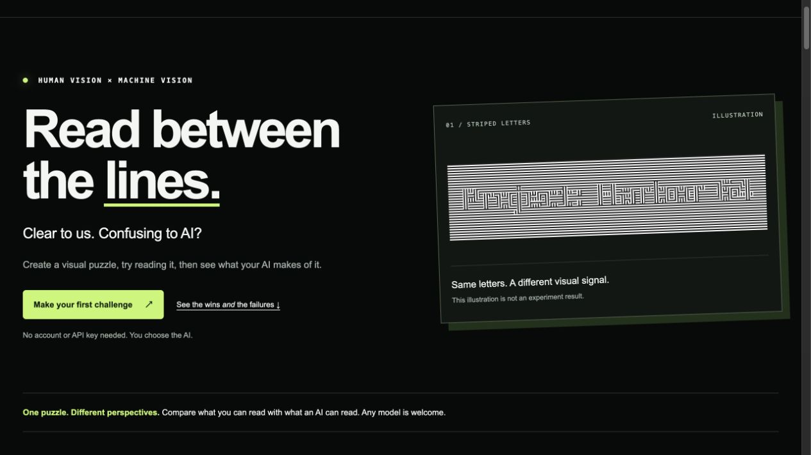

# ant.ai

### Clear to us. Confusing to AI?

A visual-perception playground exploring whether people can read patterns that AI misreads. Create striped lettering, moving-dot text, colored dots, or a word-to-code puzzle; then try the result with an AI of your choice.

**[Open the live playground](https://snehal-jindal.github.io/xai-project1-ant.ai/)** · [Try an experiment](docs/TRY_IT.md) · [See the findings](docs/FINDINGS.md) · [Research & credits](docs/REFERENCES.md)



## Start here

1. Open the website and choose a method.
2. Enter a short message, or generate a random code.
3. Read it yourself. Download it or take a screenshot and upload it to a fresh AI chat.
4. Ask the AI what it says. Compare its reply with the original answer.

No AI account is needed to use ant.ai itself. Testing an AI requires your own access to that service. No API key, dataset download, GPU, or model download is needed for this project.

**This is a research prototype, not an AI-proof CAPTCHA or document-security product.** Some examples caused errors; others were solved, including after hints. A frozen picture of moving dots is not a test of whether AI can read the animation.

## What I built—and what I found

I began with an ambitious question: could a document stay readable to people while becoming harder for AI to read? Early attempts revealed trade-offs: stronger distortion could also hurt human readability, and converting PDFs to images could bypass some obstacles. I narrowed the application to short, CAPTCHA-style visual challenges.

| Method | Observation from the selected trials | Takeaway |
| --- | --- | --- |
| Striped text | Several wrong readings; a stripe-specific hint recovered “I love AI”; “hi” was solved. | Interesting but inconsistent. Input and hints matter. |
| Moving dots | A frozen frame was unreadable; earlier tool-assisted experiments recovered other motion examples. | Test full video/frames before claiming resistance. |
| Colored dots | GPT read the colored-dot “hi.” | Not a successful barrier in that example. |
| Word → code | GPT correctly traced the submitted puzzle. | No successful blocking result demonstrated. |

The screenshots are **selected exploratory cases**, not a controlled benchmark or success rate. The public app is a JavaScript browser port; its freshly generated files differ from the original Python-rendered trial files. [Read the evidence and limitations →](docs/FINDINGS.md)

## Run it yourself

### View the ready-built website

Download this repository as a ZIP and extract it, or clone it:

```sh
git clone https://github.com/snehal-jindal/xai-project1-ant.ai.git
cd xai-project1-ant.ai
python3 -m http.server 8000 --directory dist
```

Open **http://localhost:8000**. Use a local server rather than double-clicking `index.html`, so fonts and downloads work correctly. Python is only serving static files; the generator runs in your browser.

### Edit or rebuild

Requires **Node.js 20 or newer**, npm, and a current browser.

```sh
npm ci
npm test
npm run build
npm run preview
```

Then open **http://localhost:8000**. The preview command uses Node, so Python is optional for this route.

## Find your way around

```text
src/                 Readable JavaScript: generator and website interactions
dist/                Ready-to-serve page, styles, bundle, fonts and examples
docs/TRY_IT.md       Short walkthrough and troubleshooting
docs/FINDINGS.md     Trial results, failures, uncertainty and next tests
docs/DESIGN.md       How the methods work and why the app is built this way
docs/REFERENCES.md   Research, inspiration and software attribution
evidence/trials.json Screenshot-to-result index with file hashes
tests/               Automated packaging/evidence checks
scripts/             Small local preview server
```

## Responsible AI context

The project connects **adversarial AI, human–AI interaction, and AI evaluation**. Its contribution is an interactive synthesis and documented investigation—not a claim to have invented striped fonts or motion CAPTCHA. It shows how a first wrong answer can differ from a later assisted solve, why human readability matters, and why a demo is not a deployable security system.

For deployment, I would need independent human testing, an accessible alternative, fresh randomized benchmarks across models, tests with hints and tools, and real server-side security controls. Client-side answers can be inspected: this app deliberately does not protect access to anything.

## Credits and project status

Created by **Snehal Jindal**, with AI assistance for research, implementation, iteration, and documentation. Research inspirations and external software are credited in [References](docs/REFERENCES.md). Screenshots are the creator’s supplied trial records; model settings are self-reported rather than independently verified.

The poster is submitted separately for the course and is not included here. The repo contains the current browser app—not every retired experiment, private chat, or local environment. [Reuse and third-party notices](NOTICE.md)
